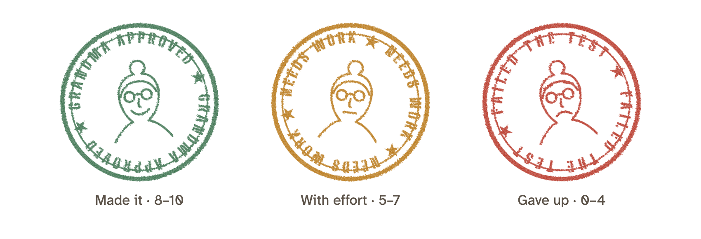
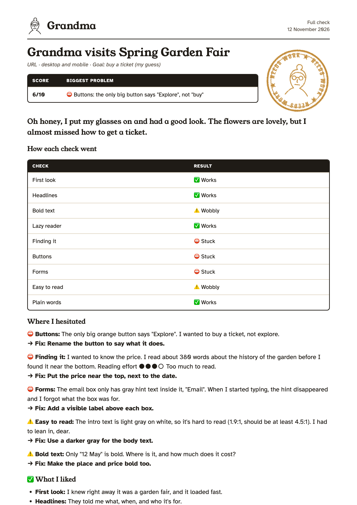

# Grandma

> "Your grandma is currently visiting your website. Guess how well that goes..."

An AI skill that checks if a landing page, a marketing email, or a screenshot works for people with limited IT skills: readers who are impatient, skim, and never read every word. Made for Claude, and built on the open Agent Skills format, so it can also run in Codex and Gemini.

Grandma reports back in her own voice. Her friend Jerry (mid-50s, good with computers, "very handsome") adds a list of fixes you can paste to your team or agency, and can rewrite the copy for you.

## What you get

`/grandma can you find the price on example.com/spring-fair?`

---

### 🌐 Can Grandma find the price?
*Spring Garden Fair · URL · desktop · Goal: find the ticket price*

| Result | Reading effort | Why |
|---|---|---|
| ⚠️ **Made it, with effort** | ●●●○ **Too much to read** | I read about 380 words before I found the price |

Oh honey, the flowers are lovely, but my tea went cold before I found what a ticket costs.

**How I got there**
Home → scrolled past 4 screens of garden history → price near the bottom (0 clicks)

**Where I hesitated**

⚠️ The only big button says "Explore". I wanted to buy a ticket, not explore.
→ **Fix: Rename the button to say what it does, like "Get your ticket".**

⚠️ The price is under the history of the garden, near the bottom of the page.
→ **Fix: Put the price at the top, next to the date.**

---

The page and the text are made up. See [examples/example-report.md](examples/example-report.md) for a full report, with Jerry's list of changes.

## What can Grandma do?

Type `/grandma` with a link, and she'll ask what you'd like. Or say it straight away:

| What you want | Example | What you get |
|---|---|---|
| **Check it** | `/grandma full check of example.com` | A score out of 10, how each part did, and what to fix |
| **Try one thing** | `/grandma can you find the price on example.com?` | Whether she made it, the path she took, and how much she had to read |
| **Compare it** | `/grandma compare example.com and other.com: can you find the price?` | Her favorite, why, what the other one does better, and what to change on yours |
| **Rewrite it** | `Jerry, rewrite it` | New headlines, buttons, and email subject lines, ready to paste |
| **Save it** | `save it as a PDF` | A branded report with Grandma's stamp: green "Grandma approved", amber "Needs work", or red "Failed the test" |

It works with:
- **Web pages:** paste the link.
- **Emails:** paste the email's preview link (the "view in browser" or share-preview link from your email tool). You can also attach a screenshot, or paste the HTML.
- **Screenshots** of anything: a page, an app, a form, or a slide.

Good to know:
- **Sharing with your team?** Say `answer in normal English` for the same report without the grandma voice.
- **For a sharper result,** tell her the main action (buy a ticket, register), your readers' top questions, and who your readers are.
- **Only some checks?** Name them: `/grandma example.com, only headlines and buttons`.

## Install

### Claude Code

```bash
claude plugin marketplace add theopelle/grandma
```

```bash
claude plugin install grandma@grandma-skill
```

Or, inside a Claude Code session (version 2.1.275 or later), in one step:

```
/plugin install grandma --marketplace theopelle/grandma
```

Then type `/grandma`. If another command already uses that name, type `/grandma:grandma`.

### Claude apps (web and desktop)

1. Download `grandma.zip` from the [latest release](https://github.com/theopelle/grandma/releases/latest).
2. In Claude, go to **Customize > Skills**, click **+**, then **Create skill > Upload a skill**.
3. Upload the ZIP file.

**Getting new features:** an uploaded skill doesn't update by itself. When a new version comes out, download the new `grandma.zip` from the [latest release](https://github.com/theopelle/grandma/releases/latest) and upload it the same way.

### Codex and Gemini (not tested yet)

Grandma uses the open Agent Skills format (a folder with a `SKILL.md`), which both tools read. We haven't tested her there yet, so please open an issue if something doesn't work.

- **Gemini CLI:**
  ```bash
  gemini skills install https://github.com/theopelle/grandma --path skills/grandma
  ```
- **Codex:** copy the `skills/grandma` folder into `~/.codex/skills/`.

To check web pages, both need a browser tool (for example a Playwright or Chrome DevTools MCP server), or Node so Grandma can use headless Chrome. Without either, she runs the text checks only.

## What the report looks like

- **The verdict first:** a small table with the result, or the score, and the reason in one line.
- **Reading effort** as a meter: ●○○○ Found it quickly, ●●○○ Had to read some, ●●●○ Too much to read, ●●●● I gave up.
- **Her path** in one line: `Home → "Get your ticket" → Ticket page (1 click)`.
- **Each problem with its fix in bold** right under it. ⛔ blocked her, ⚠️ slowed her down.
- **Jerry's list of changes** in one box, ready to copy. (Jerry's copywriting is on the generic side: make his ideas sound like your brand.)
- **As a PDF** on request. See below.

## Save it as a PDF

After any report, say `save it as a PDF` (or `export it`). Grandma puts the same report on a branded A4 page you can send to your team, your boss, or your agency.

<p align="center"></p>

Every PDF carries one stamp, with Grandma's face to match:

| Stamp | When |
|---|---|
| 🟢 **Grandma approved** (smiling) | She made it, or scored 8 to 10, or your page won the compare |
| 🟠 **Needs work** (flat face) | She made it with effort, or scored 5 to 7, or it was a tie |
| 🔴 **Failed the test** (sad) | She gave up, or scored 0 to 4, or your page lost the compare |

Jerry's face sits next to his list of changes, and the footer says "Checked by Grandma".

<p align="center"><a href="examples/example-report.pdf"></a></p>
<p align="center"><i>A made-up example. Click it to open <a href="examples/example-report.pdf">the full PDF</a>.</i></p>

How the PDF gets made:
- **Claude Code and other tools that can run commands:** Grandma prints it with headless Chrome. She uses a fresh, temporary profile, so your own Chrome, logins, and history are never touched.
- **Elsewhere:** she uses an HTML-to-PDF tool if there is one. If not, she gives you the page and you choose **Print > Save as PDF** in your browser.
- **Fonts** load from Google Fonts. Offline, the PDF uses standard fonts instead and still works.

## Why it works

An AI reads every word perfectly, but real visitors don't. Asking an AI to "pretend to skim" makes the test too easy. So this skill pulls out **only** the headlines, **only** the bold text, or **only** the buttons, and judges each one on its own, as if the rest of the page did not exist. Reading effort, contrast, loading time, and form fields are measured, not guessed.

## Who is Grandma?

Grandma stands for any impatient, non-technical reader: a busy parent on a phone, a manager between meetings, or someone reading in their second language. She's sharp, not slow. The skill never makes fun of her, of older people, or of real users: the humor comes from what the page does to her.

## What it checks

- **First look:** From the first screen only, can you tell what this is, who it's for, and what to do? Are pop-ups in the way? How long did the page take to show up?
- **Headlines:** Can you answer the key questions from the headlines alone?
- **Bold text:** Do the bold words carry the key facts?
- **Lazy reader:** Does reading only 30% of the text (headlines and first sentences) still work?
- **Finding it:** How many words does she have to read before she finds each answer?
- **Buttons:** Is there one clear main button, and do the labels say what happens next?
- **Forms:** Number of fields, missing labels, unclear required fields, and weak submit buttons. Forms are never submitted.
- **Easy to read:** Text size, how readable the text colors are (measured), and button size on phones.
- **Plain words:** Jargon, long sentences, and idioms that second-language readers may miss.
- **Inbox** (emails): Would you open it, based on the sender, subject line, and preview text?
- **Images off** (emails): Does the message still work when images are blocked?

## Requirements

- **Web pages and email preview links:** a browser. Grandma looks at the page as a first-time visitor, so she picks the cleanest one available:
  1. Claude's built-in browser (Cowork and the desktop app), or a Playwright or Chrome DevTools MCP server.
  2. Headless Chrome, where Claude can run commands (for example Claude Code). It needs Node. Grandma asks before installing the small helper it uses (playwright-core, about 15 MB), and before downloading a browser if Google Chrome isn't installed (about 150 MB).
  3. Claude in Chrome. It uses your own Chrome, so the report notes that cookie banners and logins may differ from a first visit.

  Without any of these, she runs the text checks only.
- **Screenshots:** work anywhere.
- **Emails from your email tool:** a connector for that tool (for example HubSpot or Mailchimp) lets Grandma find the email by name. A preview link or a screenshot works without one.

## Safety

Grandma never submits forms, buys anything, logs in, or types personal data. She only reads pages and takes screenshots.

## Limits

- Loading times are measured from the AI's browser, so they depend on the connection. Treat them as a rough signal.
- Screenshot results are estimates. Colors and sizes can't be measured from an image.
- This is a quick, low-cost check. It does not replace testing with real users.

## Contributing

Ideas and fixes are welcome. Please open an issue or a pull request. Keep the skill simple: every new check makes reports slower and longer.

To publish a new version, bump `version` in `.claude-plugin/plugin.json`, then push a matching tag (for example `v1.1.0`). GitHub then builds `grandma.zip` and attaches it to the release.

## License

[MIT](LICENSE)
